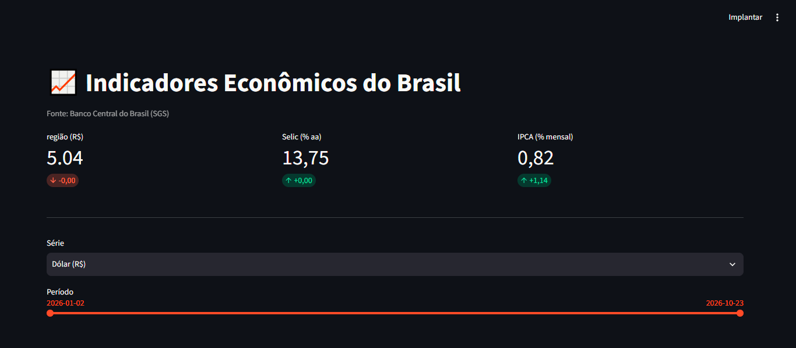
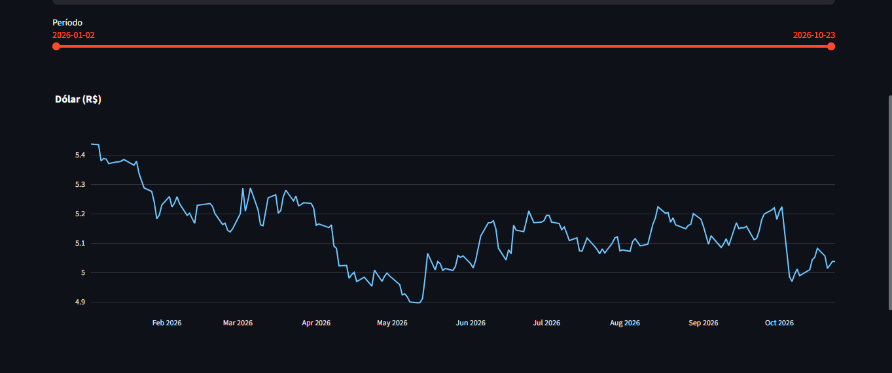
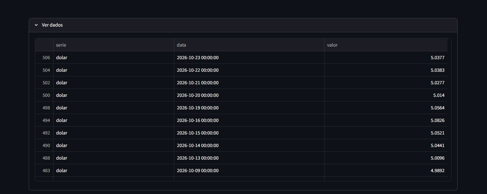
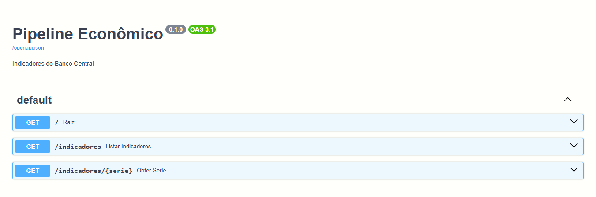
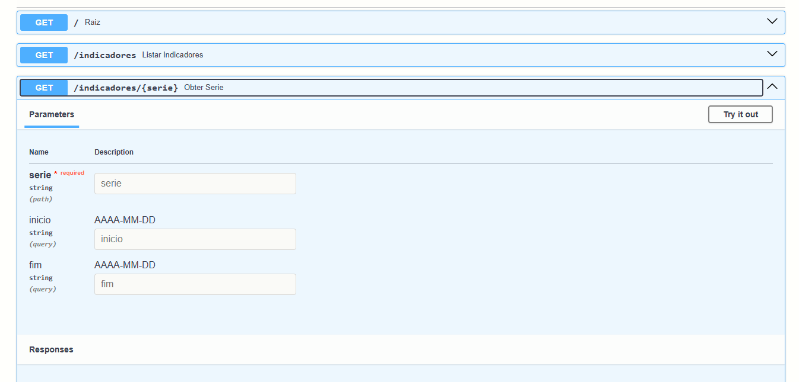
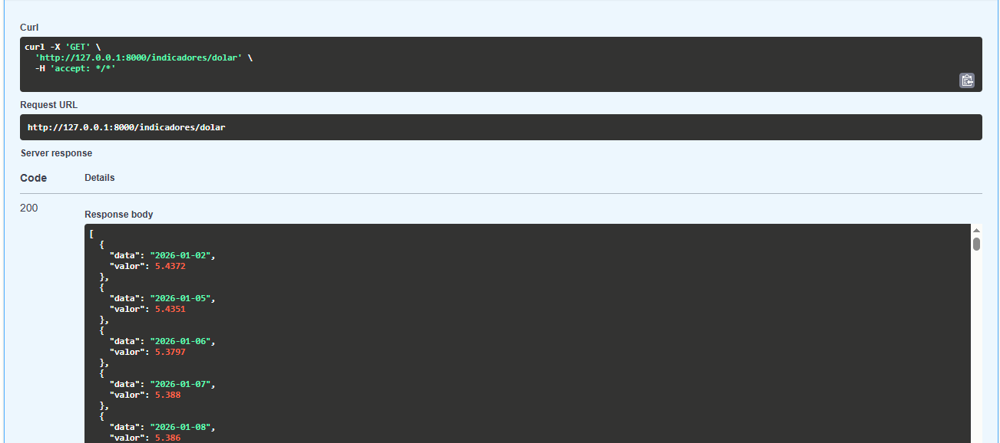

# Pipeline Econômico

Pipeline de dados que coleta indicadores econômicos do Banco Central do Brasil, armazena num banco SQLite, expõe numa API REST e mostra num dashboard interativo.

## Demonstração

### Dashboard




### API




## Indicadores

| Série | Código SGS | Periodicidade |
|-------|-----------|---------------|
| Dólar (venda) | 1 | diária (dias úteis) |
| Selic (meta) | 432 | diária |
| IPCA | 433 | mensal |

Fonte: [API de Séries Temporais do Banco Central (SGS)](https://dadosabertos.bcb.gov.br/), aberta e sem necessidade de chave.

## Stack

Python, pandas, requests, SQLite, FastAPI, Streamlit, Plotly, pytest, GitHub Actions

## Arquitetura

```
API do BCB -> coleta.py -> carga.py -> indicadores.db -> API (FastAPI)
                                                      -> Dashboard (Streamlit)
```

- **`pipeline/coleta.py`**: busca as séries na API do BCB, com retry e espera crescente.
- **`pipeline/carga.py`**: grava no SQLite com chave primária (série + data), então rodar duas vezes não duplica dados.
- **`pipeline/main.py`**: orquestra a coleta **incremental**, buscando só o que ainda não está no banco.
- **`api/main.py`**: endpoints para consultar as séries.
- **`dashboard/app.py`**: cartões com o último valor, seletor de série, filtro de período e gráfico.

## Decisões técnicas

- **Coleta incremental:** a cada execução, parte do dia seguinte à última data guardada.
- **Dia atual fora da coleta:** a API do BCB rejeitou consultas com a data de hoje como data final, então o pipeline busca até o dia anterior.
- **Períodos sem dados:** a API devolve 404 em fins de semana e feriados. O pipeline trata isso como "nada novo", sem falhar.
- **Isolamento de falhas:** se uma série falhar, as outras continuam sendo coletadas.

## Endpoints da API

| Método | Rota | Descrição |
|--------|------|-----------|
| GET | `/indicadores` | Lista as séries, com quantidade de registros e período |
| GET | `/indicadores/{serie}` | Valores da série, com filtros `inicio` e `fim` (AAAA-MM-DD) |

Exemplo: `/indicadores/dolar?inicio=2026-10-01`

Documentação interativa em `/docs`.

## Como rodar

```bash
git clone https://github.com/m4th3u5-4c5/pipeline_economico.git
cd pipeline_economico
python -m venv .venv
.venv\Scripts\activate          # Linux/Mac: source .venv/bin/activate
pip install -r requirements.txt

python pipeline/main.py          # coleta e salva os dados
uvicorn api.main:app --reload    # API em http://127.0.0.1:8000/docs
streamlit run dashboard/app.py   # dashboard em http://localhost:8501
```

## Testes

```bash
pytest -v
```

Os testes cobrem a carga (sem duplicação e última data), a coleta (parse, 404 e esgotamento de tentativas, com a API simulada) e a API (200 e 404). Rodam automaticamente a cada push via GitHub Actions.

## Próximos passos

- [ ] Deploy do dashboard
- [ ] Coleta agendada diária
- [ ] Alerta de variação diária acima de um limite
- [ ] Validação de valores fora do esperado antes de gravar
- [ ] Mais séries (IGP-M, PIB, desemprego)

## Autor

Matheus, [GitHub](https://github.com/m4th3u5-4c5)